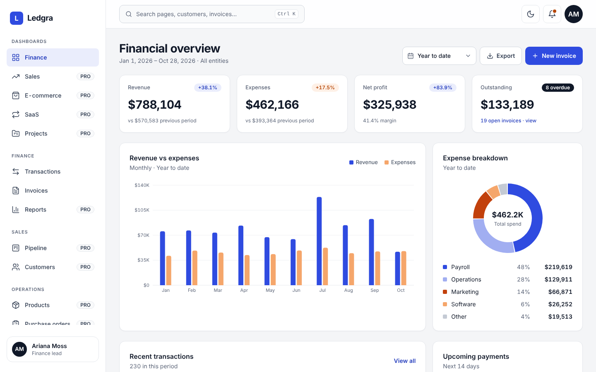

# Ledgra Lite

Free React admin dashboard template for finance apps, built with React 18, TypeScript, Tailwind CSS and Recharts.



**[Live demo of Ledgra Pro](https://ledgra-demo.netlify.app)** · **[Get Ledgra Pro](https://temkaole.gumroad.com/l/ledgra)**

## What's included

- Finance dashboard with KPIs, cash flow chart and expense breakdown
- Transactions table with search, filters, sorting, pagination and CSV export
- Invoices list with status filters
- Settings: brand name, primary color, currency and theme
- Sign in, register and forgot-password pages with form validation
- Light and dark mode, fully responsive, ⌘K command palette
- One seeded data set: every KPI, chart and table agrees

## Quick start

Requires Node.js 18 or newer.

```bash
npm install
npm run dev
```

Open the address Vite prints (usually http://localhost:5173).

```bash
npm run build     # production build in dist/
npm run preview   # serve the build locally
```

## Customize

| What | Where |
|---|---|
| App name, logo, default currency, colors | `src/config/app.config.ts` |
| Sidebar menu | `src/config/navigation.ts` |
| Social sign-in buttons, demo account | `src/config/auth.ts` |
| Color tokens (light and dark) | `src/index.css` |
| Demo data | `src/data/` |

## Lite vs Pro

| | Lite (free) | Pro |
|---|:---:|:---:|
| Finance dashboard | ✓ | ✓ |
| Sales, E-commerce, SaaS and Projects dashboards | | ✓ |
| Transactions and invoices list | ✓ | ✓ |
| Invoice detail and invoice builder | | ✓ |
| CRM pipeline and customers | | ✓ |
| Reports and P&L statement | | ✓ |
| Inventory and purchase orders | | ✓ |
| Employees and payroll | | ✓ |
| Task board, calendar, notifications, profile, pricing | | ✓ |
| Auth pages, settings, light and dark mode | ✓ | ✓ |
| Screens | 7 | 27 |
| Documentation and email support | | ✓ |

Menu items marked **PRO** open an upgrade page in Lite. To hide them, delete those lines in `src/config/navigation.ts`.

**[Get Ledgra Pro →](https://temkaole.gumroad.com/l/ledgra)**

## Tech stack

React 18 · TypeScript (strict) · Vite · Tailwind CSS · Recharts · TanStack Table · React Hook Form + Zod · React Router · Lucide icons

## License

Ledgra Lite is released under the [MIT License](LICENSE). Third-party packages keep their own licenses, see [CREDITS.md](CREDITS.md).

Ledgra Pro is a separate commercial product and is not covered by this license.

---

Made by **Steppe UI**.
